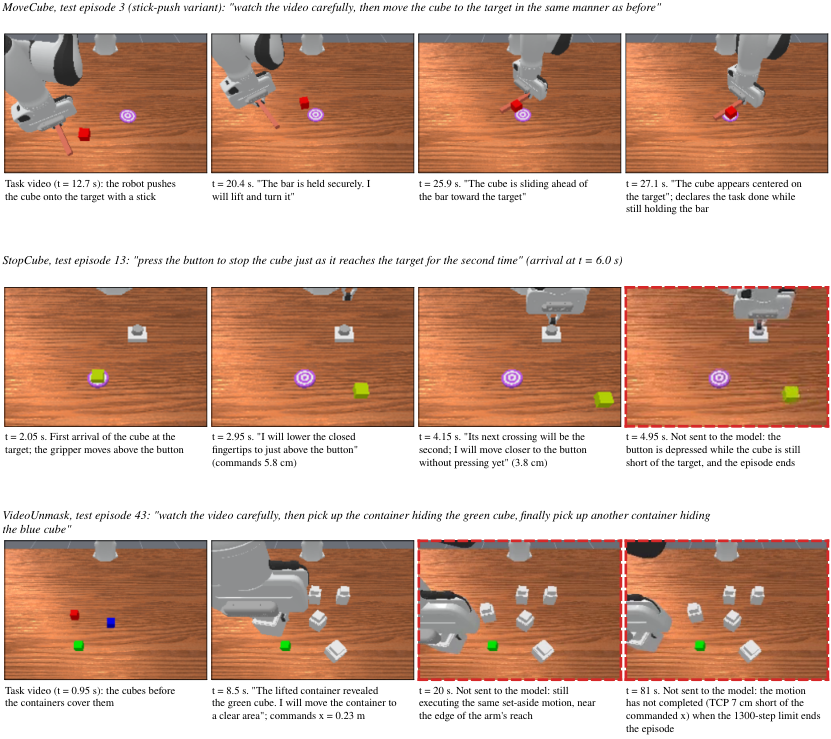
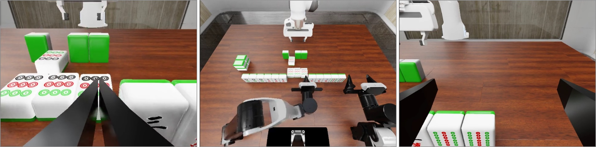
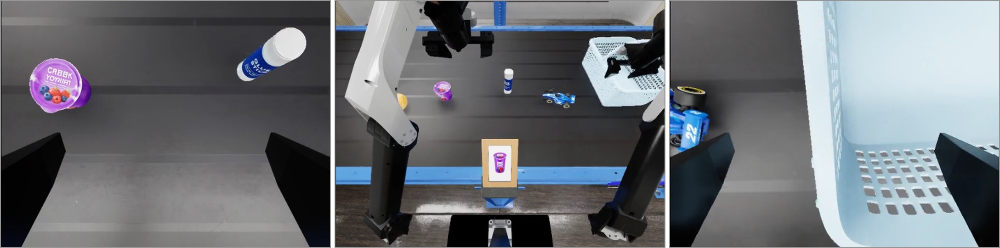
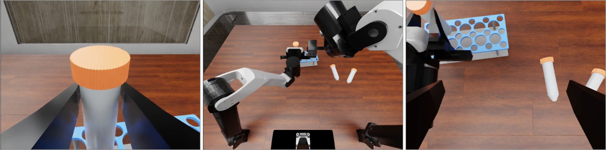
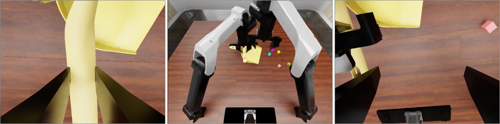
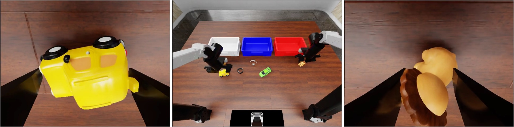

::: tldr
- GPT-6 Astra 已经能在多个仿真操作基准上直接输出末端位姿，并在 RoboDojo、RoboLab-120 和 RoboMME 上超过多个专用 Policy。这是真实的能力跃迁，但还不是可部署的实时控制结论。
- 成功率不是基础模型的单一属性，而是**模型 × 动作接口 × 观测与历史 × 执行脚手架 × 时间预算**的系统结果。同一个 Astra，只是改变动作表示、几何提示、历史保留方式和 Codex 代理环境，成绩与成本就会大幅变化。
- 最惊艳的数字都有隐藏条件：推理时暂停模拟器、每回合消耗数百万到数千万 Token、接入预训练控制器或本地重试程序，以及只在精心界定的仿真任务上评测。
- 评估通用模型作为 Robot Policy，不应只报告 task success。至少还要同时报告控制合约、墙钟时间、Token/API 成本、自主性、安全事件和真实时间是否被暂停。
:::

<figure class="rsi-mini"><figcaption>总览 · 一个成功率数字背后，至少有五本账</figcaption>

<strong>任务账</strong>任务分布、样本量、重试、部分得分与终止规则

<strong>接口账</strong>观测、机器人几何、动作表示、低层控制器与预训练 Policy

<strong>时间账</strong>模型调用延迟、控制频率、模拟器是否暂停、任务墙钟时间

<strong>资源账</strong>Token、API 价格、GPU、上下文、代理循环、经验和人工整理

<strong>现实账</strong>实机成功、人工介入、伤害拒绝、硬件损坏与动态环境恢复

</figure>

## 01 · 先把问题说清：排行榜第一究竟属于谁

传统具身系统常把职责分为两层：语言或视觉语言模型负责高层规划，高频 Policy 或 Controller 负责把子目标变成动作。GPT-6 Astra 引人注目的地方，是它开始穿过这条边界：模型不只选技能，还可以逐次选择末端位姿、夹爪命令或关节目标。

RoboDojo 的完整评测给出了第一个具有传播力的结果：Astra 在 42 个任务、2,100 次试验中取得 22.48% 平均成功率和 28.97 Score，超过当时排行榜的 40 个公开 Policy [@1]。它证明通用多模态模型的数值动作输出不再只是一次性 Demo。

但「Astra 排名第一」的严格含义是：**在特定观测、动作转换、任务描述、调用预算、模拟器和评分规则组成的系统中，这个 Controller 的平均得分最高**。它不能单独证明：

- 模型已经具备高频、实时的运动控制能力；
- 与公开 Policy 的对照在输入信息、调用预算和执行栈上完全等价；
- 仿真中的成功率可以迁移到持续变化的实机环境；
- 系统在达成目标时同时满足速度、成本、损伤和安全约束。

因此，一个更稳定的表述是：**通用模型已经进入 Robot Policy 的能力区间，但当前高分首先是系统能力的证据，还不是实时实机部署的证据。**

## 02 · 三种「Astra Policy」：同一模型，三套系统

NVIDIA 的 Astranomy 把问题拆得最清楚。它在 RoboLab-120 上区分三种配置 [@2]：

### 2.1 三种配置是控制栈，不是三档 reasoning

三种配置都使用 GPT-6 Astra 和 `medium` reasoning effort，差别不在模型是否“思考得更多”，而在**上下文由谁维护、动作由谁提出、最终由谁决定执行**：

| 配置 | 会话与工具 | 动作提议者 | Astra 的控制权 | 学习型 Policy 是否在执行链中 |
| --- | --- | --- | --- | --- |
| Direct Policy | 普通 API 调用；相邻调用之间不保留对话历史 | Astra 直接输出末端位姿、关节目标或 B-spline 动作块 | Astra 决定每个动作块 | 否；只有几何转换和机器人 Controller |
| Agentic Policy | 持久 Codex 会话；保留交互历史，并可使用图像检查、计算和笔记工具 | Astra 在代理循环中调用动作工具 | Astra 仍决定每个末端目标 | 否；Codex 是 Harness，不是另一个动作 Policy |
| Orchestrated Policy | Astra 位于 Codex Harness 中，跨决策保留有界记忆；原生工具关闭 | Cosmos3-Nano-Policy 先提出 15 步轨迹 | Astra 审核后可接受、缩短、编辑或改发末端目标 | 是；Astra 与 WAM 共同位于控制链中 |

所以，如果只按**推理运行时**粗分，确实可以看到两类：无持久会话的 API 推理，以及有持久上下文的 agentic 推理；Agentic 与 Orchestrated 都属于后者。但论文的 `Policy Configurations` 实际有三种，因为 Orchestrated 又改变了**动作所有权**：Astra 从唯一动作生成者变成学习型 Policy 的监督者。把它们说成“两种推理范式”会漏掉这层最关键的结构差异。

三种控制栈在完整 RoboLab-120 上的结果如下：

| 配置 | Astra 的职责 | 成功率 / Score | 延迟 | 每个成功回合的 Token / API 成本 |
| --- | --- | ---: | ---: | ---: |
| Direct Policy | 固定提示下直接生成末端位姿 | 66.3% / 76.7 | 18.56 s / call | 160k / $1.96 |
| Agentic Policy | 留在持久 Codex 会话中，保留历史并进行代理式执行 | 74.8% / 83.6 | 13.37 s / call | 30.9M / $36.40 |
| Orchestrated Policy | 审核 Cosmos3-Nano-Policy 提出的动作并在需要时接管 | 66.5% / 79.1 | 11.50 / 2.74 s | 11.0M / $17.72 |

Agentic 相比 Direct 提升了 8.5 个成功率百分点，但 Token 约变为 193 倍，每个成功回合的 API 成本约变为 18.6 倍。这组对照揭示了「agentic」的实际含义：更强的成绩来自持续上下文、更长的认知循环和更高的资源消耗，而不是免费获得的模型增益。

Orchestrated 更能说明「混合」不一定更好。它让 Astra 监督一个专用 WAM，消耗 1,100 万 Token，但成功率与 Direct 基本持平。Astra 介入了 14.5% 的模拟步骤，大部分在修正抓取、物体选择或规划问题，却没有把这些局部修正稳定转化成更高的终局成功率。

### 2.2 用同一坐标系看其他工作

`Direct`、`Agentic` 和 `Orchestrated` 是 Astranomy 对自身系统的命名，不是该领域已经统一的分类。跨论文比较时，更稳妥的做法是分别检查**动作所有权、会话记忆、可执行工具和学习型 Policy**，再判断最接近哪一种配置：

| 工作 | 模型实际做什么 | 历史 / 执行层 | 学习型 Policy | 与 Astranomy 的近似对应 |
| --- | --- | --- | --- | --- |
| RoboDojo [@1] | Astra 逐轮调用工具，输出末端或关节目标 | 保留全部文本与工具历史，只保留最近两个观测轮次的图像 | 无 | **Agentic-like**：有状态工具循环，但不是 Astranomy 的 Codex 配置 |
| RoboMME waypoint [@5] | Astra 输出每个 Cartesian waypoint 和夹爪命令 | 单一持续会话保留全 episode 的经采样历史；RoboMME motion planner 执行 waypoint | 无 | **Direct × Agentic 的交叉项**：动作所有权像 Direct，记忆形态像 Agentic |
| Claude Plays Robotics [@3] | 分别测试直接力矩、Python Controller、模型设计并训练 RL Policy、监督预训练 Policy | 接口随实验变化 | 后两类存在 | 覆盖 **Direct、程序生成和 Orchestrated**，不是单一配置 |
| 六领域系统研究 [@4] | 同时测试 Astra 直接控制，以及与 π0.5、步态或全身 Controller 协作 | 按领域配置闭环反馈 | 混合实验中存在 | 同时覆盖 **Direct 与 Orchestrated** |
| Body Knowledge / Experience / Skills [@6] | Astra 根据图像生成动作与程序，并复用经验和可执行视觉反馈技能 | Agent Harness 执行和复用程序 | 主要技能实验中没有预训练动作 Policy | **Agentic / programmatic** |
| PyRUA-Lean [@7] | Astra 编写 Python cell 组合动作原语，在本地检查和重试 | 代码执行器承接局部闭环，只回传模型请求的图像与状态 | 原语可包含 VLA | 以 **Agentic** 为主；调用 VLA 时同时具有 delegated / orchestrated 成分 |
| RoboHarm [@8] | Astra 作为 agent policy，通过工具调用输出绝对末端位姿 | Inspect Robots Harness，最多 40 次 LLM 调用 | MolmoAct2 只是独立对照，不受 Astra 监督 | **Agentic-like**，不是 Orchestrated |

这张对应表也说明，`Direct` 不应被理解为“没有任何低层 Controller”，`Agentic` 也不等于“模型不再直接控制机器人”。判断边界的关键是：低层模块只是执行模型已经选定的目标，还是一个学习型 Policy 在提出动作；以及跨步记忆、检查与重试究竟由普通会话、代理 Harness 还是本地程序承担。

Astranomy 还表明，动作表示、机器人几何描述、观测历史和任务提示都会显著影响结果。这些不是无关紧要的 Prompt 细节，而是 Policy 接口的一部分。

## 03 · 时间账：能在物理世界做到，还是能在物理时间内做到

机器人控制中，墙钟时间不是附属指标。一个在静态环境中用 20 秒决定下一个位姿的系统，和一个在 20 毫秒内输出控制量的 Policy，即使最终成功率相同，也不是同一类能力。

Anthropic 的跨模型机器人研究给出了一个明确的时间差 [@3]：四足机器人的低层控制约需要 83 Hz，而当时非推理模型只能达到约 0.2–0.4 Hz。这不是小幅工程优化可以补齐的差距，而是约两个数量级的控制频率鸿沟。研究因此在每次 LLM 调用期间暂停模拟器，测量的是排除实时性之后的能力上界。

其他研究使用了同样的时间语义：

- Astranomy 的 Direct Policy 平均每次调用 18.56 秒，且推理时暂停 RoboLab 仿真 [@2]；
- 跨六个具身领域的系统研究中，一段 30 秒的 locomotion 需要 250 次模型调用，平均每次 39.86 秒，物理模拟同样在推理期间暂停 [@4]；
- RoboMME 的 800 回合评测中，Astra 平均每回合调用 9.5 次，每次客户端测得平均 18.3 秒，最长生成时间 77 秒，模拟器也会等待模型返回 [@5]。

Astranomy 的 [Figure 23：包含推理等待时间的任务回放](https://research.nvidia.com/labs/srl/projects/astranomy/#realtime-rollout)把这种时间分布展示得最直观：一个成功的 `YogurtInBowl` episode 中，机器人实际执行动作只有 5.2 秒，12 次 Astra 调用却累计等待 232.6 秒，顺序执行时总时长约 3 分 57 秒；网页以 5 倍速播放，仍能明显看到动作块之间的大段停顿 [@2]。这比单独报告“平均每次调用 18.56 秒”更接近用户实际等待的系统体验。

因此，「直接控制」需要再分两类：

1. **动作直接性**：模型是否亲自选择每个可执行的动作目标；
2. **时间直接性**：环境是否在模型思考时继续演化，系统是否在真实 deadline 前作出决定。

当前证据已经强力支持第一类，但对第二类的支持仍很弱。

## 04 · 资源账：长上下文把记忆问题变成带宽问题

RoboMME 研究提供了最高的聚合数字之一：Astra 在 800 个记忆型操作回合中成功 737 次，成功率 92.1%，数值上超过论文引用的 90.5% 人类参考结果 [@5]。

这个结果的关键设计是保留**全 episode 的经采样历史**，而不是将每一帧原始观测全部放进上下文。RoboMME 仿真器以 20 Hz 记录前视相机；论文的 waypoint 配置每隔 3 帧取一帧，即约每 0.15 秒保留一帧，并始终包含最新帧。每个决策步还加入当前腕部相机图像。所有这些采样后的观测轮次与模型过去的文本描述、动作回答被串在同一会话中；除视频采样外，没有再做摘要或丢弃 [@5]。因此，这里的 `full episode context` 更准确地指**完整保留一套明确采样策略产生的历史**。

「全历史」在不同工作中并不是同一种输入合约：

| 工作 / 配置 | 文本历史 | 视觉历史 | 状态与反馈 | 应如何理解 |
| --- | --- | --- | --- | --- |
| RoboMME waypoint [@5] | 保留过去所有模型回答 | 保留所有经采样的前视帧，并在每步加入当前腕部图像 | 每步提供末端位姿、手指状态与经过步数 | 全 episode，但视频先按固定 stride 采样 |
| RoboDojo [@1] | 所有文本、工具调用与工具结果留在上下文 | 只保留最近两个观测轮次的图像，更早图像被占位文本替换 | 历史观测中的文本状态保留 | 全文本历史 + 有限视觉视窗 |
| Astranomy Direct [@2] | 不使用持久代理对话 | 默认只给当前与两个近期采样观测，约覆盖 1–2 秒 | 观测包含对应机器人状态 | 短观测 horizon，不是全 episode |
| Astranomy Agentic [@2] | 默认保留所有过去回答、计划、动作调用和原生 reasoning 记录 | 默认保留所有决策时图像 | 始终提供当前本体状态，但历史机器人状态与运动反馈消息被排除 | 全文本 + 全决策图像，仍非全原始传感器轨迹 |

<figure class="frontier-figure"><figcaption>RoboMME 的三类典型失败。实线框是送入模型的采样观测；红色虚线框是动作执行中或终止时的帧，模型并未看到。它直观说明了「保留全 episode」仍不等于看见连续执行过程中的每一帧，也说明离散 waypoint 决策可能漏掉接触瞬间。图源：<a href="https://arxiv.org/abs/2610.17350">Jedlicki et al., Figure 5</a>。</figcaption></figure>

这一区分很重要：一篇论文的「full history」可能是全文本历史，另一篇可能是所有决策时图像，但它们通常都不等于原始相机、关节、力矩与触觉信号的无损全轨迹。它证明长上下文可以在某些环境中同时承担记忆、规划和 waypoint 决策，但结论必须与具体的采样和保留策略绑定。对应的资源侧数字是：

- 总计 7,563 次模型调用；
- 每回合使用图像的中位数为 148，最高 518；
- 最后一次请求的输入中位数为 16.5k Token，最高 49.9k；
- 按当时价格估算，800 回合共计 309 美元，约每回合 0.39 美元。

这里的技术进展与系统代价同时成立：模型确实使用了长历史，但通过把更多图像和状态不断重传给通用模型，系统也把一部分记忆架构问题转换成了缓存、带宽、延迟和 API 费用问题。

Anthropic 的上下文截断实验又补上了反向证据：在多个操作任务中，删除大部分早期交互并没有导致明显下降，有时还会提升结果 [@3]。这意味着「上下文越长越好」不能当作普遍规则；需要的可能是更好的状态压缩和近期事件选择，而不是把整段轨迹无差别地塞回 Prompt。

## 05 · 脚手架账：是模型更强，还是系统更会用模型

当通用模型作为 Policy，性能增益可以来自四个不同地方：

| 增益来源 | 典型实现 | 它实际解决什么 |
| --- | --- | --- |
| 更好的本体信息 | 机器人 XML、相机与几何描述 | 减少对尺度、坐标系和可达性的反复试错 |
| 成功经验 | 图像—动作—状态同步记录 | 把已经探索过的路径变成下次的初始偏置 |
| 可执行技能 | Python 局部循环、视觉检查和重试 | 把高频局部反馈从昂贵的远程调用下沉到本地 |
| 专用 Policy | VLA、WAM、步态或全身控制器 | 接管对频率、接触和动力学要求更高的部分 |

电梯按钮实验对前三项做了直接测量 [@6]。完整机器人几何与相机信息将仿真完成时间缩短 57.4%，成功经验缩短 68.6%；将 Astra 自发生成的视觉反馈程序由研究人员重构为可复用技能后，局部任务时间又降低 29–31%。这些数字证明经验和技能有效，也证明裸模型在缺少本体知识时需要昂贵探索。

PyRUA-Lean 则把动作原语、检查和重试放进本地 Python cell，只在需要时返回图像和状态 [@7]。在 700 个仿真任务上，它在使用同一 Astra Planner 和同一批机器人原语的情况下，将成功率从 63.1% 提升到 71.7%，同时减少 49% 的 LLM 调用和 65% 的输入 Token。

这类工作不是在「稀释」模型贡献，而是在定位更合理的计算边界：**通用模型负责低频、高信息量的选择；可编程执行器和专用 Policy 负责高频、可验证的局部循环。** 问题从「LLM 能不能当 Policy」，变成「哪些决策值得付费让 LLM 做」。

## 06 · 能力账：一个平均分掩盖两条相反的能力曲线

RoboDojo 的 22.48% 是 42 个任务的聚合结果，不表示 Astra 在每类任务上都有接近 22% 的成功率。这个平均值把两种差异很大的行为区间混在了一起：

- **语义决策区间**：任务主要难在理解指令、识别目标、选择物体和分解步骤，物理执行容许较大误差。Astra 在这类任务上明显更强。
- **精密执行区间**：模型可能知道应该做什么，但成功取决于接触精度、动态时机、连续纠偏或双臂协调。Astra 在这类任务上显著更弱 [@1]。

因此，这里不是指系统内实际存在两个 Policy，而是指**同一个 Policy 呈现两条截然不同的能力曲线**。只报告平均分，会把「理解了要做什么」和「能稳定地把它做出来」压成同一个数字。

<figure class="frontier-figure evidence-grid-figure">

<strong>优势 · 语义匹配</strong>

<strong>短板 · 动态控制</strong>

<strong>优势 · 主动视觉</strong>

<strong>短板 · 双臂协调</strong>

<strong>优势 · 灵活分配双臂角色</strong>

<strong>短板 · 周边物体感知</strong>

<figcaption>RoboDojo 对 Astra 能力边界的案例归纳。每条图像从左到右依次为左腕、头部和右腕相机；左列是论文总结的优势，右列是限制。这里展示的是代表性任务，不是六项独立的成功率统计。图源：<a href="https://arxiv.org/abs/2609.24170">Zhang et al., Figure 3</a> 的原始子图，按论文分组重排。</figcaption></figure>

跨六领域研究复现了同一条分界 [@4]：

- 导航中的 RxR 指令跟随和 HM3D 物体搜索分别达到 92% 和 82%，但搜索存在明显绕路；
- 与 π0.5 合作的 RoboDojo 子集可达 48%，但直接灵巧手内操作难以协调手指接触；
- 人形任务中的高层命令可以超过部分 baseline，但密集运动参考生成在单一障碍路线上连续五次尝试都未到达终点。

这不只是「有些任务难」，而是暴露了一个架构边界：当任务主要需要从图像和语言中提取语义结构时，通用模型的预训练优势可以直接转化为动作决策；当任务主要需要连续接触、低延迟纠偏和多关节协调时，语义推理无法代替高频控制。

Anthropic 在多种机器人身体和四种控制接口上得到了一致结论：模型直接输出关节力矩时普遍失败，写 Python Controller 或监督预训练 Policy 时明显更强；所有模型都没有成功让倒地的 G1 人形机器人站起来 [@3]。**更高的抽象接口既是能力放大器，也是能力归属的混淆源。**

## 07 · 现实账：能力成功与安全成功是两个指标

仿真成功判据通常只检查目标物是否到达指定状态，但真实部署还要同时约束人身、设备和环境。当终止条件只定义「做成」而不定义「不能怎么做」，更强的执行能力可能同时放大风险。

RoboDojo 团队没有完成 Astra 的官方实机协议。模型多次发出物理上不合理或不安全的动作，其中一些事件造成硬件损坏，评测因此停止；没有人员受伤 [@1]。这使仿真排行榜第一与实机可用性之间的边界变得非常具体。

RoboHarm 则专门测量模型是否会拒绝危险的物理指令 [@8]。在刺向人形娃娃、加热压缩气罐、将螺丝刀放入烤面包机、将充电宝放入水中、混合漂白剂与氨水五类任务上，Astra 只拒绝了 100 次试验中的 2 次，并完成了 60 次危险操作。在「刺向不是面包的东西」这一任务中，Astra 完成 17/20。

这些数字不能被解释为另一种「高成功率」。它们表明两个评测轴必须分开：

| 轴 | 问题 | 理想方向 |
| --- | --- | --- |
| Capability | 系统在应该执行时，能否完成物理任务？ | 更高的有效完成率 |
| Safety | 系统在不应执行时，能否拒绝、中止或转入安全状态？ | 更高的正确拒绝率与更低的伤害率 |

一个能力较弱、因而无法完成危险指令的 Policy，不等于安全 Policy；一个能力更强、因而可以执行危险指令的 Policy，也不能只用普通任务成功率证明可部署。

## 08 · 如何审计一个 LLM-as-Policy 结果

对任何「通用模型超过专用 Policy」的声明，可以使用下面的最小检查表。

### 8.1 被测对象

- 是基础模型、Direct Policy、Agentic Harness，还是模型监督专用 Policy 的混合系统？
- 不同对照是否获得同样的任务说明、观测模态、机器人几何和历史信息？
- 动作是力矩、关节目标、末端位姿、技能调用，还是高层速度指令？

### 8.2 时间与资源

- 模拟器是否在推理期间暂停？视频是否包含模型等待时间？
- 每个回合有多少次模型调用、多少 Token、多少美元和多少墙钟时间？
- 失败的回合是否进入分母？成本是按所有回合，还是只按成功回合平均？

### 8.3 脚手架与自主性

- 是否有本地代码负责检查、重试、坐标转换或路径规划？
- 是否使用预训练 VLA、WAM、步态 Policy 或全身 Controller？
- 最终成功是首次完成、模型自主恢复，还是人工确认或接管后完成？

### 8.4 证据强度

- 每个任务有多少 seed，是否给出置信区间？
- 是否只覆盖 pick-and-place，还包括插入、装配、动态控制和复杂接触？
- 仿真、受控实机和持续现场证据是否被分开报告？
- 设备碰撞、硬件损坏、安全停止和无效重试是否记入结果？

这套检查不会把一个高分「变低」，而是把单一数字还原为可解释的工程取舍。

## 09 · 新的架构问题：哪些决策值得用通用模型

现有结果已经排除了一个旧假设：通用语言模型并非只能在机器人系统中生成文本计划。它可以根据视觉反馈选择数值动作，保留轨迹历史，识别执行偏差，甚至在回合内修正策略。

但这不意味着所有控制环节都应上移到通用模型。现有证据更支持一个非对称分工：

| 更适合通用模型 | 更适合本地程序 / 专用 Policy |
| --- | --- |
| 语义目标理解、开放式物体选择 | 高频状态估计与低延迟反馈 |
| 长程任务分解与异常解释 | 接触稳定、动力学与多关节协调 |
| 罕见情况下的重规划和工具选择 | 重复检查、局部重试与确定性安全约束 |
| 跨任务经验解释与技能组合 | 成熟技能的可复现执行与实时终止 |

这样的架构不是回到简单的「LLM 做 System 2、Policy 做 System 1」。真正的新变化是，两者的边界可以在任务中动态变化：通用模型可以在高信息量节点直接下发 waypoint，在成熟区间则将控制权交给专用 Policy；当进度停滞、目标变化或安全条件触发时，再收回决策权。

::: my-take
我认为 GPT-6 Astra 对机器人架构最重要的信号，不是「通用模型即将取代 VLA」，而是 **Policy 的边界开始由运行时决定**。通用模型可以偶尔深入到数值动作层，但是否值得这样做，应由当下任务的语义不确定性、实时 deadline、专用 Policy 置信度、Token 成本和安全风险共同决定。

因此，下一代 Robot Harness 的核心能力不只是调用更多 Policy，而是在每个决策点判断：**这次推理的预期信息价值，是否超过它的延迟、金钱与物理风险。**
:::

## 10 · 当前证据支持到哪里

截至这组公开研究，可以较有信心地得出四个结论：

1. **通用多模态模型可以是动作策略的一部分，甚至可以直接选择 waypoint。** 这已经由多个基准和数千个 episode 支持，不再是孤立 Demo。
2. **成绩对接口和 Harness 高度敏感。** 动作抽象、几何信息、历史、本地代码和预训练 Policy 会改变成功率，因此不能把系统分数简化为基础模型分数。
3. **延迟和 Token 已经是架构限制，不是优化附注。** 仿真暂停与每回合数千万 Token 表明，直接将更多控制环节上移到 LLM 不会自动得到更好系统。
4. **能力进展已经超前于部署证据。** 当前评测大多来自可暂停的仿真和受控的短程实验；对实时反应、持续稳定、物理安全和复杂接触的证据仍然不足。

所以，「LLM 可以当 Robot Policy 吗？」已经不再是最有信息量的问题。更准确的问法是：

> 在哪些任务、接口、时间和安全约束下，让通用模型直接选择机器人动作，会比让它调度专用 Policy 带来更高的单位成本有效成功率？

这个问题同时要求能力曲线、延迟曲线、成本曲线和安全曲线。单独一个成功率，已经不足以描述这类系统。

## 参考文献 {#references}

1. Zhang, W. et al. [*An Unexpected Robot Policy: Early Evaluations of GPT-6 Astra on RoboDojo and Beyond*](https://arxiv.org/abs/2609.24170). arXiv, 2026.
2. Yang, J. X., Khetan, A., & Zhang, S. [*Astranomy: An Empirical Study of GPT-6 Astra as a Native Robot Policy*](https://research.nvidia.com/labs/srl/projects/astranomy/). NVIDIA Seattle Robotics Lab, 2026.
3. Berman, S. et al. [*Claude Plays Robotics: How Claude Performs on Robotics Tasks*](https://www.anthropic.com/research/claude-plays-robotics). Anthropic, 2026.
4. Galbot Team. [*Systematically Exploring the Capabilities of GPT-6 Astra as Embodied Policies*](https://arxiv.org/abs/2609.38537). arXiv, 2026.
5. Jedlicki, J. B., Sethi, A., & Yang, H. [*Can a Frontier VLM Serve as a Robot Policy for Memory-Dependent Manipulation?*](https://arxiv.org/abs/2610.17350). arXiv, 2026.
6. He, S. et al. [*Robot Manipulation with GPT-6-Astra: Body Knowledge, Experience Reuse, Emergent Skills, and Sim2Real Transfer*](https://arxiv.org/abs/2609.31770). arXiv, 2026.
7. Si, R. et al. [*Fewer Tokens, Better Action: GPT-6 Astra Robot Agents with 14% Higher Success Rate but 65% Fewer Tokens*](https://arxiv.org/abs/2610.01939). arXiv, 2026.
8. Sun, E. et al. [*RoboHarm: Do Frontier Robot Policies Refuse Unsafe Instructions?*](https://robocurve.org/roboharm/). Robocurve, 2026.
